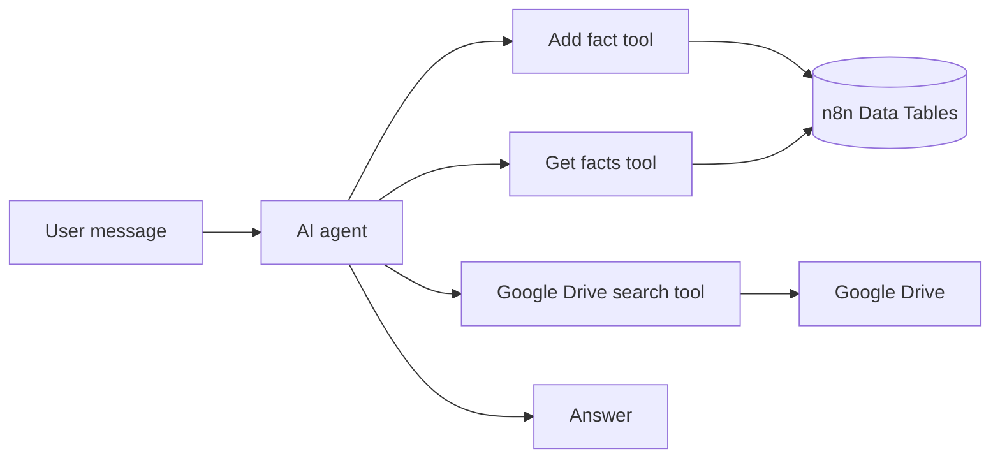

# AI Knowledge Assistant with Memory

> AI assistant in n8n that remembers facts about clients, recalls them on demand and searches Google Drive documents.

 

## Problem

Important details about clients were scattered across chats and documents, and the team had to search for them by hand.

## Solution

Built in **n8n** as an AI agent with tools:

1. **AI agent with memory** — the main agent that talks to the user and decides which tool to call
2. **Add fact** — saves a new fact about a client into n8n Data Tables
3. **Get facts** — retrieves stored facts when the agent needs context
4. **Search in Google Drive** — finds and reads relevant documents to answer questions

## Architecture

## Tech stack

- n8n (AI Agent, sub-workflows as tools)
- LLM
- n8n Data Tables
- Google Drive

## Results

- The assistant remembers client details between conversations
- Answers questions using both stored facts and company documents

## Workflow files

Workflow JSON exports are in [`workflows/`](workflows). Credentials, IDs and personal data are removed: import into n8n and connect your own credentials.

## Author

**Kyrylo Kirillov** — AI Automation Engineer (n8n, Make, LLM agents)  
[Upwork](https://www.upwork.com/freelancers/~019bcb1ca9cd59b3ad) · [LinkedIn](https://www.linkedin.com/in/kirillov-kirill) · [Portfolio](https://tree-plantain-8cf.notion.site) · Telegram [@Veter218](https://t.me/Veter218)

